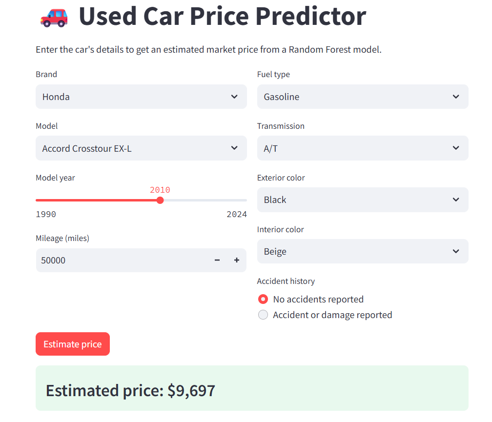
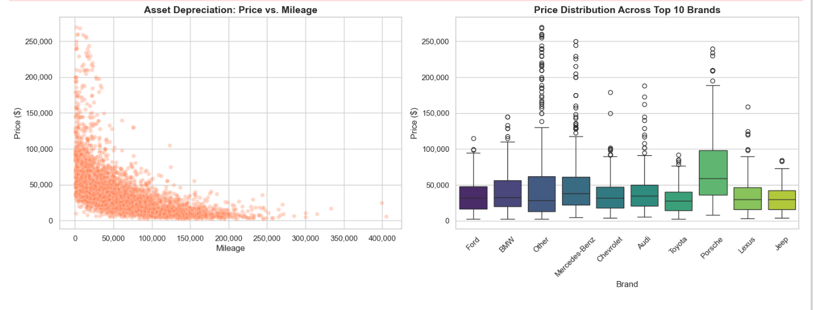
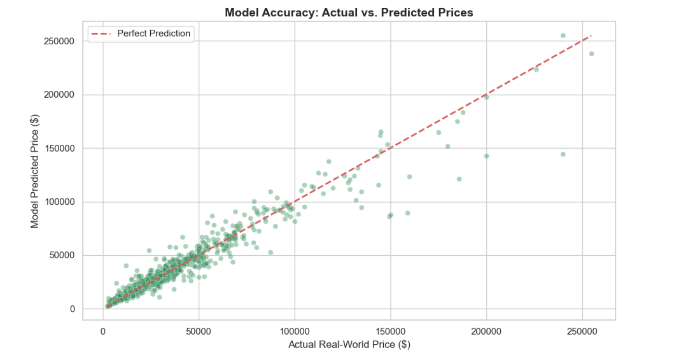
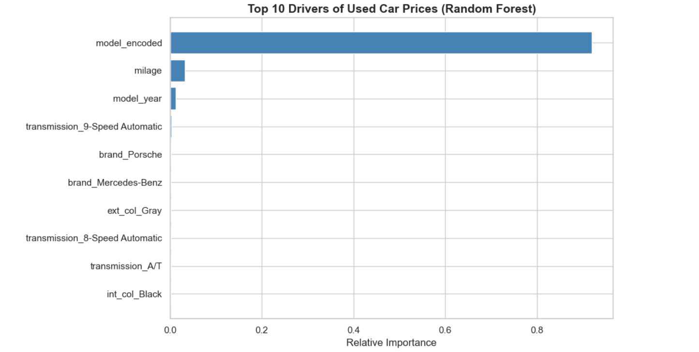

# 🚗 Used Car Price Prediction

An end-to-end machine learning project that predicts the market price of a used car from its specifications, deployed as a live web app.

**🔗 Live demo:** [your-app-name.streamlit.app](https://your-app-name.streamlit.app)



---

## Overview

| | |
|---|---|
| **Problem** | Regression: predict a used car's price in USD |
| **Data** | ~4,000 US used-car listings (brand, model, year, mileage, fuel, transmission, colors, accident history, price) |
| **Algorithm** | Random Forest Regressor (Scikit-Learn) |
| **Deployment** | Streamlit Community Cloud |
| **Tools** | Python, Pandas, NumPy, Matplotlib, Seaborn, Scikit-Learn, Joblib, Streamlit |

---

## Project Workflow

### 1. Data cleaning
- `price` (`$10,300`) and `milage` (`51,000 mi.`) were stored as text, so I stripped the symbols and converted both to numbers.
- Missing values were found in `fuel_type` (170), `accident` (113) and `clean_title` (596).

### 2. Outlier handling
- The price distribution was heavily right-skewed. The 99th percentile was about $272k, but the maximum was **$2.95M**.
- I removed the top 1% of prices (41 rows), which brought the maximum down to about $270k and left **3,968 rows**.

### 3. Feature engineering
The biggest challenge was **high cardinality**. Plain one-hot encoding would have created thousands of columns and made the app slow and memory-hungry.

| Column | Problem | What I did |
|---|---|---|
| `clean_title` | Only one unique value, so no signal | Dropped |
| `engine` | 1,146 unique text values, redundant with `model` | Dropped |
| `brand`, `ext_col`, `int_col`, `transmission` | Many rare categories | Grouped any category under 1% of rows into **"Other"** (brand 57 → 27, exterior color 319 → 10, interior color 156 → 10, transmission 62 → 19) |
| `model` | 1,878 unique values, but the strongest price signal | **Target encoding**: replaced each model with its average price |
| Remaining categoricals | Low cardinality | One-hot encoding with `drop_first=True` |

The final model uses **72 features**.

### 4. Exploratory analysis
**Depreciation and brand price spread**



Price falls as mileage rises, and prices vary a lot between brands, with luxury brands showing a much wider spread.

### 5. Model training
- 80/20 train-test split (`random_state=42`)
- `RandomForestRegressor(n_estimators=100)`
- I chose Random Forest because it handles mixed numeric and encoded features well, captures non-linear effects like depreciation, and needs little feature scaling.

**Actual vs. predicted prices**



**Feature importance**



The target-encoded car model dominates the importance ranking, which confirms that the feature engineering step carried most of the predictive signal.

### 6. Hyperparameter tuning
I ran `GridSearchCV` over **90 combinations** (3-fold CV, scored on MAE):

| Parameter | Values searched |
|---|---|
| `n_estimators` | 50, 100, 200, 300, 350, 400 |
| `max_depth` | None, 10, 20 |
| `min_samples_split` | 2, 3, 4, 5, 10 |

| Model | MAE | R² |
|---|---|---|
| Baseline (100 trees) | $5,130.79 | 0.925 |
| Tuned (400 trees) | $5,120.12 | 0.926 |

**Decision: I deployed the baseline model.** The tuned model improved MAE by only about **$10**, while 4× more trees means a much larger model file, slower predictions and more memory use on a free hosting tier. The default tree settings (`max_depth=None`, `min_samples_split=2`) were already optimal, so the extra compute wasn't worth a negligible gain.

### 7. Deployment
- The trained model, the feature column list and the model-to-price lookup were saved with Joblib.
- The Streamlit app rebuilds the same 72-feature row from the user's inputs, so training and inference stay consistent.
- Dropdown options come from the model's own feature columns, and the model list is filtered by the selected brand.

---

## Project Structure

```
├── model/
│   ├── app.py                 # Streamlit app
│   ├── build_lookup.py        # builds car_options.json (brand -> models)
│   ├── car_options.json
│   ├── car_price_model.pkl    # trained Random Forest
│   ├── model_columns.pkl      # the 72 feature columns
│   └── model_mean_prices.pkl  # target-encoding lookup
├── screenshots/
├── notebook.ipynb   # full analysis and training
├── used_cars.csv              # dataset
├── requirements.txt
└── README.md
```

## Run Locally

```bash
git clone https://github.com/satyamsenpaii1/Used_car_price_prediction.git
cd Used_car_price_prediction
pip install -r requirements.txt
streamlit run model/app.py
```
